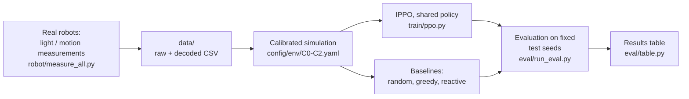

# CATaclysm

Two Codey Rocky robots find a light source (a flashlight on the target) without a camera, without a central controller and without talking to each other about positions. Each robot decides only from its own sensors. The policy is trained with multi-agent reinforcement learning (IPPO) in a simulation that we calibrated on real measurements from our robots.

Course: "Artificial Intelligence", Ukrainian Catholic University, autumn 2026. Status: **midterm** (simulation and trained behaviour). Transfer to the real robots is planned for the final defense.

## Team

| Name | GitHub | Role |
|---|---|---|
| Yuliia Sova | [@JuliaSovaO](https://github.com/JuliaSovaO) | Repository setup, `SPEC.md`, midterm presentation, project skeleton |
| Oksana Dziuba | [@Dandaizyer](https://github.com/Dandaizyer) | Real-robot measurements and calibration, training and evaluation, results, README |

## Problem and motivation

A swarm of cheap robots has to work as a team even when no robot knows the whole picture. Our main goal is **decentralized coordination**: every robot acts only on its own local sensors, and the group behaviour comes from the shared policy, not from a central planner.

The concrete task is reach a static light source (the target) inside an arena. Robots have no camera, so the direction to the target has to come from the light sensor. Pursuit of a moving target and obstacle avoidance are optional extras and are not the focus of this project. Constraints of the course setup: only 2 robots, only the built-in sensors of Codey Rocky and a computer, a small flat arena.

## Approach



1. **Simulation** (`src/cataclysm/env/`). A PettingZoo parallel environment. Each robot gets an 8-number observation: front IR obstacle reading, light level, change of light since the last step, whether the other robot is seen by IR, and the last action. There are 4 discrete actions: forward, turn left, turn right, stop. One step is 0.2 s.
2. **Calibration.** We measured the head light sensor against distance and angle with a bright flashlight, in a dark room, and measured robot speed and turn rate. The light law, the sensor cone, the arena size and the turn rate in `config/env/C*.yaml` come from these measurements (see the table below and `data/README.md`).
3. **Training** (`src/cataclysm/train/`). IPPO with one policy shared by both robots (parameter sharing). The actor and critic use only local inputs, so the policy can run on each robot independently. A frame stack of 4 steps gives short memory. Curriculum: C0, then C1, then C2.
4. **Baselines** (`src/cataclysm/baselines/`), all without learning and all using only the robot's own observation. `random` picks random actions. `greedy` is the hand-written rule "scan, align, go": the robot makes a full turn on the spot, remembers where the light was brightest, turns there and drives forward, then scans again; it avoids an obstacle when the light is still weak. `reactive` is the same rule plus a simple rule to keep away from the other robot.
5. **Evaluation** (`src/cataclysm/eval/`). Fixed test seeds, success rate with a confidence interval, steps, collisions.

### Simulation levels

| Level | What it is |
|---|---|
| `L0`-`L3` | Idealized levels (bigger arena, assumed sensor), used for development and tests. Not used for the numbers in this README. |
| `C0` | Calibrated. One robot reaching the target is enough. |
| `C1` | Calibrated. Both robots must reach the target. |
| `C2` | Calibrated. Adds 2 to 4 obstacles and noise in motion and distance sensing. |

### What we measured on the real robots

| Quantity | Value | How |
|---|---|---|
| Arena | 200 x 200 cm | measured |
| Light sensor (head), bright flashlight | signal is about `1.44e6 / d^2` on the 0-100 scale (d in cm), saturates at 100 below about 120 cm | readings at 10-175 cm |
| Sensor cone | close to `cos^1.15` of the angle, nearly zero at 90 degrees | angles 0-90 at 100 cm (saturated at small angles, so this is the least certain value) |
| Light noise | standard deviation 0.1 to 0.8 of 100 | 20-100 samples per point |
| Front sensor of Rocky | reads 100 at all distances with this flashlight, so it is not used | measured |
| Forward speed | 15 cm/s | motion tests |
| Turn rate | about 150 deg/s (about 30 deg per step) | motion tests |

Measurements are in `data/` (raw hex output from the robots and the decoded CSV). The scripts that run on the robot are in `robot/`.

## Results

Calibrated simulation, fixed test seeds 10000-10199 (200 episodes per policy and level). For PPO we trained 3 seeds (0, 1, 2), so 600 episodes in total, and report the mean over seeds. Success means the target was reached within 500 steps (100 s). Produced by `python -m cataclysm.eval.table results/*.csv`.

| Policy | Level | Episodes | Success rate [95% CI] | Mean steps | Obstacle collisions | Robot-robot collisions |
|---|---|---|---|---|---|---|
| random | C0 | 200 | 0.080 [0.050, 0.126] | 486 | 36.0 | 3.4 |
| random | C1 | 200 | 0.000 [0.000, 0.019] | 500 | 34.2 | 2.1 |
| random | C2 | 200 | 0.000 [0.000, 0.019] | 500 | 38.4 | 3.0 |
| greedy | C0 | 200 | 0.970 [0.936, 0.986] | 144 | 0.1 | 7.9 |
| greedy | C1 | 200 | 0.755 [0.691, 0.809] | 245 | 0.6 | 30.4 |
| greedy | C2 | 200 | 0.665 [0.597, 0.727] | 347 | 30.1 | 11.8 |
| reactive | C0 | 200 | 0.975 [0.943, 0.989] | 142 | 0.1 | 6.4 |
| reactive | C1 | 200 | 0.770 [0.707, 0.823] | 242 | 0.6 | 27.6 |
| reactive | C2 | 200 | 0.710 [0.644, 0.768] | 340 | 33.0 | 8.1 |
| **PPO (mean of 3 seeds)** | C0 | 600 | **1.000 +- 0.000** | 56 | 0.0 | 0.7 |
| **PPO (mean of 3 seeds)** | C1 | 600 | **1.000 +- 0.000** | 76 | 0.0 | 3.7 |
| **PPO (mean of 3 seeds)** | C2 | 600 | **0.998 +- 0.003** | 103 | 7.2 | 2.2 |

Results of PPO for each training seed (200 test episodes each):

| PPO seed | C0 success | C1 success | C2 success | C2 mean steps |
|---|---|---|---|---|
| 0 | 1.000 | 1.000 | 1.000 | 93 |
| 1 | 1.000 | 1.000 | 1.000 | 110 |
| 2 | 1.000 | 1.000 | 0.995 | 106 |

How to read this:

- PPO is much better than the best hand-written baseline on the levels that need two robots (C1: 1.000 against 0.770, C2: 0.998 against 0.710) and is about 2.5 times faster on C0 (56 steps against 142). The gap is largest where cooperation and obstacles matter. The three seeds give almost the same result, so this is not luck of one run.
- The random policy shows that the task is not trivial: it reaches the target in only 8% of episodes on C0 and in none on C1 and C2.
- **These are results in the simulation, not on the real robots.** A success rate of 1.000 in the simulation does not mean that the real robot will reach 1.000.

## Quick start

```bash
git clone https://github.com/JuliaSovaO/CATaclysm && cd CATaclysm
python -m venv .venv
source .venv/bin/activate                 # Windows PowerShell: .venv\Scripts\Activate.ps1
pip install -r requirements.txt
export PYTHONPATH=src                     # Windows PowerShell: $env:PYTHONPATH="src"
python -m pytest -q                       # tests
```

Reproduce the key result (no GPU needed):

```bash
# 1. train three seeds
for S in 0 1 2; do python -m cataclysm.train.ppo --seed $S --levels C0,C1,C2; done

# 2. evaluate baselines and trained policies on the fixed test seeds
for L in C0 C1 C2; do
  for P in random greedy reactive; do
    python -m cataclysm.eval.run_eval --policy $P --level $L --episodes 200 --out results/${L}_${P}.csv
  done
done
for S in 0 1 2; do for L in C0 C1 C2; do
  python -m cataclysm.eval.run_eval --policy ppo:models/ippo_seed$S/best.pt \
    --label ppo --train-seed $S --level $L --episodes 200 --out results/${L}_ppo_seed$S.csv
done; done

# 3. print the results table
python -m cataclysm.eval.table results/*.csv
```

For a quick check, add `--total-steps 300000` to the training command (a few minutes, lower accuracy).

## Repository structure

```
.
├── src/cataclysm/
│   ├── env/            # simulation (SwarmEnv), light and sensor model, config loader
│   ├── baselines/      # random, greedy, reactive
│   ├── train/          # IPPO (ppo.py), policy wrapper, shared networks
│   ├── eval/           # run_eval.py (episodes on fixed seeds), table.py (summary)
│   └── viz/            # rendering of episodes
├── config/
│   ├── env/            # base.yaml, L0-L3 (idealized), C0-C2 (calibrated)
│   └── train/ppo.yaml  # all training hyperparameters and seeds
├── robot/              # MicroPython scripts for Codey Rocky (measurements)
├── data/               # real measurements
├── tests/              # unit tests for env, training, evaluation
├── models/             # trained weights, NOT committed (created by training)
├── results/            # evaluation CSVs, NOT committed (created by evaluation)
└── SPEC.md             # full technical specification and changelog
```

## Reproducibility

- **Seeds.** Training seeds are 0, 1 and 2 (`config/train/ppo.yaml`). Episode seeds are split: 0-8999 for training, 9000-9999 for choosing the best checkpoint, 10000-10199 for the final test. The test seeds are never used for training or checkpoint choice.
- **Config.** Every hyperparameter and every simulation constant is in `config/`. Nothing is hard-coded in `src/`.
- **Runtime.** About 20 minutes per seed for 2 million agent steps on a CPU.
- **Environment.** Python 3.10 to 3.13 (we ran it on 3.13; `torch` may not have wheels for the newest Python), packages in `requirements.txt`. The numbers above come from one laptop and the exact versions of `torch` and `numpy` installed there. A run on another machine with other library versions should give very similar, but not necessarily identical, numbers.
- **Models and results are not in git**, because they are regenerated by the commands above.

## Known limitations

- Everything above is simulation. Running the trained policy on the real robots (sim-to-real) is the plan for the final defense. Open items: loop timing on the robot, range of the robot-to-robot IR link, repeated motion tests.
- With the bright flashlight the head sensor saturates at 100 closer than about 120 cm, so inside this zone a robot does not see the light level change. The policy has to cope with this using the sensor edges and the other robot's signal.
- The sensor cone was measured at a distance where the sensor is saturated at small angles, so its exact shape is estimated from a few points.
- Motion noise in C2 is an estimate. The front light sensor of Rocky is unusable with this flashlight and is not used.
- Pursuit of a moving target and the hardest level `L3` are outside the midterm scope and are not trained.

## AI usage

| Tool | Used for | How the result was checked |
|---|---|---|
| Claude  | Helped with the first version of the simulation, baselines, the IPPO training code, the MicroPython measurement scripts. | 27 unit tests in `tests/`. We ran the training and the evaluation ourselves on our own computers, with fixed seeds, and the tables above come from our runs. The measurements were taken by us on our robots, and the calibration values come from those measurements.|

## Contribution statement

| Member | Responsible for |
|---|---|
| Yuliia Sova | Project skeleton and repository cleanup (commits "project skeleton", "cleaned repo, added SPEC.md"), `SPEC.md`, midterm presentation |
| Oksana Dziuba | All real-robot measurements and their decoding, calibrated levels `C0`-`C2`, PPO training and evaluation (3 seeds), results tables, README |


## Acknowledgments

Course "Artificial Intelligence", Ukrainian Catholic University. Hardware: Makeblock Codey Rocky. Simulation interface: [PettingZoo](https://pettingzoo.farama.org/).